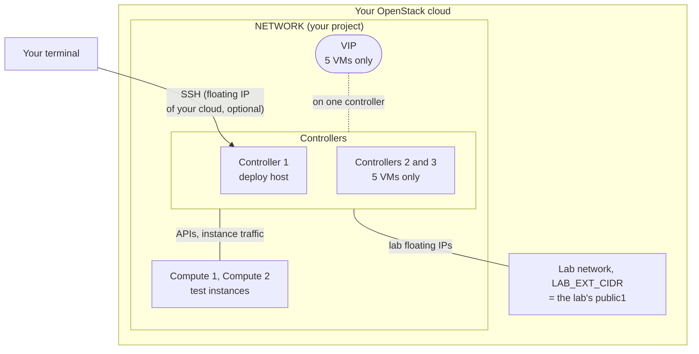

# OpenStack on several VMs of an OpenStack cloud (multinode)

A multinode OpenStack (2026.1, deployed with Kolla-Ansible) on 3 or 5 VMs of an OpenStack cloud (tested on one cloud so far), in a little over
an hour. One command deletes it all. It shows what one VM cannot: instances moving between computes, a compute that
dies, and, with 5 VMs, a controller that dies.

## Quick start

```bash
cp config.example.env config.env && $EDITOR config.env   # OS_CLOUD, NETWORK, SSH_FROM, the two prices; FLOATING_NETWORK if you use one; CONTROLLERS="3" for 5 VMs
./create.sh                                              # shows the cost of all the VMs, asks, creates them (3 to 4 min)
./deploy.sh                                              # deploys OpenStack across them (60 to 70 min)
ssh -i .state/quicklab-multi-1/id_ed25519 ubuntu@<controller-1-address>   # then, on controller 1:
source ~/kolla-venv/bin/activate; . /etc/kolla/admin-openrc.sh; openstack server list
./destroy.sh                                             # back on your computer: deletes everything, after asking
```

- **`SSH_FROM`** and **a dropped connection**: as in the single-VM [quick start](../openstack-cloud/README.md#quick-start).
- **Time**: plan about 75 minutes (3 VMs) to 90 minutes (5 VMs) before your first exercise: 63 and 73 minutes
  measured for `create.sh` and `deploy.sh`, plus filling in `config.env` and logging in.

Read [the cost risk](#the-cost-risk) first. It runs 3 to 5 VMs, so it costs 2.5 to 4.5 times the
[single-VM variant](../openstack-cloud/README.md). The rest of this page is the detail.

> **Status:** both sizes were run end to end on 2026-10-25, from `create.sh` to `destroy.sh` (figures below);
> `destroy.sh` left nothing behind either time.

## What you get



- **All the VMs** have their address in your project network (`NETWORK`). You reach controller 1 on that
  address, or on a floating IP of your cloud if you set `FLOATING_NETWORK`.
- **Controllers** run the control plane and the network services. Controller 1 is also the deploy host: you work
  there.
- **Computes** run `nova-compute` and the test instances.
- **The lab network** (`quicklab-multi-1-ext`, range `LAB_EXT_CIDR`) is created by the scripts. It carries the lab's
  own floating IPs (`public1`, inside the lab) and is attached to the controllers only. It is not the floating IP
  of your cloud.
- **The VIP** exists with 3 controllers only: an address of `NETWORK` that keepalived moves between them. With
  1 controller, the API address is controller 1's.

### The two sizes

One setting in `config.env`, `CONTROLLERS`, chooses the size: `"1"` (the default) or `"3"`.

| Size | `CONTROLLERS` | VMs | Roles | Required quota |
|---|---|---|---|---|
| **Small** (default) | `"1"` | 3 | 1 controller (also the network node and the deploy host), 2 computes | 12 vCPU, 32 GB RAM, 3 instances |
| **HA** | `"3"` | 5 | 3 controllers (also network nodes; controller 1 is the deploy host), 2 computes | 20 vCPU, 64 GB RAM, 5 instances |

- `create.sh` picks, for each role, the smallest flavor with at least 4 vCPU and 50 GB of disk: 16 GB of RAM for a
  controller, 8 GB for a compute. Set `CONTROLLER_FLAVOR` or `COMPUTE_FLAVOR` to force one.
- The quota must also allow: one network and its subnet (the lab network); one port per VM, plus one per controller,
  plus one more for controller 1 (and one more for the VIP with 3 controllers); one floating IP if you reach the lab
  from outside the cloud.

### The three commands

| Script | What it does | Measured, 3 VMs | Measured, 5 VMs |
|---|---|---|---|
| `create.sh` | Creates the VMs, their key, security group and ports, the lab network (and the VIP port with 3 controllers), and, if you want one, a floating IP for controller 1. Shows the estimated cost per hour and per day for all the VMs and asks before creating anything | 3 min 15 s | 3 min 38 s |
| `deploy.sh` | Prepares every VM, installs Kolla-Ansible on controller 1 and deploys OpenStack across the VMs: the control plane and the network services on the controller(s), `nova-compute` on the computes. Ends with a test instance on each compute and a live migration | 59 min 34 s | 69 min 13 s |
| `destroy.sh` | Deletes everything `create.sh` created, after asking, and checks that nothing is left | 1 min 14 s | 1 min 53 s |

## The cost risk

**Every VM costs money every hour it exists**, used or not, until you run `./destroy.sh`. On the reference cloud,
per hour, 3 VMs cost about two and a half times the single-VM variant, and 5 VMs about four and a half times. A lab
forgotten overnight costs that much more too.

| Your cloud | What to do |
|---|---|
| **Prepaid** | Spending cannot go beyond the credit you loaded. Check your provider's own terms before you rely on it. |
| **Pay-as-you-go** | Set a budget alert in your provider's console **before** you start. Destroy the lab the same day. |

`create.sh` computes the estimate and waits for your confirmation:

- `COST_PER_HOUR_CONTROLLER` and `COST_PER_HOUR_COMPUTE`: the price of one VM of each flavor, from your provider's
  price list. Each is multiplied by the number of VMs of that role.
- `COST_PER_HOUR_EXTRA`: what your provider bills apart (root volumes, the floating IP).
- It shows the total per hour and per day. It refuses to start while the two prices are empty, unless you run
  `./create.sh --no-cost-estimate`.

### What a lab cost on the reference cloud

Measured on the reference cloud, a prepaid OpenStack cloud (see the [home page](../../README.md#pick-your-lab)). It
bills per second. Prices are its pay-as-you-go prices per hour, as listed on 2026-10-23 and checked again on
2026-10-25. The EUR prices are the page's own, not a conversion of the TND ones. The page says nothing about taxes.

| Resource | Used by the lab | TND per hour | EUR per hour |
|---|---|---|---|
| Flavor `G0.basic.4c16g` (4 vCPU, 16 GB, 50 GB disk) | Each controller | 0.196 | 0.057 |
| Flavor `G0.basic.4c8g` (4 vCPU, 8 GB, 50 GB disk) | Each compute | 0.140 | 0.041 |
| Floating IP | Only if you set `FLOATING_NETWORK` | 0.015 | 0.005 |

| | 3 VMs (small) | 5 VMs (HA) |
|---|---|---|
| Per hour | 0.476 TND (0.139 EUR) | 0.868 TND (0.253 EUR) |
| Each day the lab is left running | 11.42 TND (3.34 EUR) | 20.83 TND (6.07 EUR) |
| One run, measured on 2026-10-25 | `create.sh` to `destroy.sh`, 65 min 27 s: 0.52 TND (0.15 EUR) | `create.sh` to the end of `deploy.sh`, 72 min 50 s: 1.05 TND (0.31 EUR); a build followed at once by `destroy.sh`, about 75 min: 1.08 TND (0.32 EUR) |

- The figures for a run are the measured duration multiplied by the listed prices, not an amount read from an
  invoice.
- Add 0.015 TND (0.005 EUR) per hour if you use a floating IP.
- The exercises add their own time, at the hourly rate above.
- On the reference cloud, set `COST_PER_HOUR_CONTROLLER="0.196"`, `COST_PER_HOUR_COMPUTE="0.140"`,
  `COST_PER_HOUR_EXTRA="0"` (`"0.015"` with a floating IP) and `CURRENCY="TND"`, or the EUR prices with
  `CURRENCY="EUR"`.

## Safety rules

The same as the [single-VM variant](../openstack-cloud/README.md):

- **A cost estimate is required.** `create.sh` refuses to start without `COST_PER_HOUR_CONTROLLER` and
  `COST_PER_HOUR_COMPUTE`, unless you run `./create.sh --no-cost-estimate`.
- **Nothing is created before you confirm.** `create.sh` lists what it will create, with the estimated cost per hour
  and per day, and waits for your answer.
- **Every resource is named from the prefix** `${PREFIX}${LAB}-` (default `quicklab-multi-1-`). See
  [how resources are named](#how-resources-are-named).
- 🛑 **`destroy.sh` deletes everything in the project whose name starts with `${PREFIX}${LAB}-`**, after listing it
  and asking. Keep `PREFIX` specific to the lab: never a prefix that other resources of your project share.
- **Destroy checks that nothing is left.** It lists every kind of resource again after deleting, and fails loudly if
  anything of the lab is still there.

## What you need

- An account on an OpenStack cloud, with the quota of the size you choose (above).
- The same tools, `clouds.yaml`, network and access as the single-VM variant: see its
  [what you need](../openstack-cloud/README.md#what-you-need).
- The right to create a network, a subnet and ports with port security disabled in your project: the lab's
  floating IPs live on a network the scripts create.
- **Nested virtualisation** on the hosting cloud, so that instances on the lab's computes run with KVM. Live migration
  between two computes works with `qemu` too, but is much slower.
- **For the HA size**, check before you pay for 5 VMs:
  - The hosting cloud must let the controllers share a virtual IP (allowed address pairs on their ports).
    `openstack extension list --network | grep -i allowed-address-pairs` on your account tells you, if your
    provider's documentation does not.
  - It must pass VRRP (IP protocol 112) between them. Only your provider or a test between two VMs can tell. The
    scripts use keepalived in unicast mode, so multicast is not needed.
  - The pattern's
    [context](https://github.com/OzarLand/kolla-ansible-deployment-patterns/blob/main/topologies/three-controllers-two-computes-nested-in-an-openstack-cloud.md#context)
    lists what was measured on the hosting cloud before designing the lab. Its
    [network design](https://github.com/OzarLand/kolla-ansible-deployment-patterns/blob/main/topologies/three-controllers-two-computes-nested-in-an-openstack-cloud.md#network-design)
    shows how the virtual IP and VRRP are set up.

## Steps

```bash
cp config.example.env config.env
$EDITOR config.env            # OS_CLOUD, NETWORK, SSH_FROM, the two prices; CONTROLLERS="3" for the HA size
./create.sh                   # shows what it will create and the cost for all the VMs, asks, creates
./deploy.sh                   # about an hour; can be run again after a failure, it resumes
ssh -i .state/<prefix><lab>/id_ed25519 ubuntu@<controller-1-address>
source ~/kolla-venv/bin/activate; . /etc/kolla/admin-openrc.sh
openstack server list          # demo1 and demo2, one on each compute
./destroy.sh                  # when you are done: deletes everything, after asking
```

`<controller-1-address>` is controller 1's floating IP if you set `FLOATING_NETWORK`, its address in `NETWORK`
otherwise. `deploy.sh` prints the full `ssh` command at the end.

### How resources are named

Everything starts with `${PREFIX}${LAB}-`, `quicklab-multi-1-` by default:

| Resource | Name |
|---|---|
| VMs | `quicklab-multi-1-ctl-1` (and `-ctl-2`, `-ctl-3` with 3 controllers), `quicklab-multi-1-cmp-1` and `-cmp-2` |
| Ports | `<vm>-port` on every VM; `<vm>-ext` on the controllers; `quicklab-multi-1-ctl-1-gw`; `quicklab-multi-1-vip` with 3 controllers |
| Lab network | `quicklab-multi-1-ext` and its subnet |
| Security group, key | `quicklab-multi-1-sg`, `quicklab-multi-1-key` |
| Root volumes (only when a flavor has no disk) | `<vm>-root` |
| Floating IP | Carries the lab's name in its description |

`destroy.sh` finds them all by these names, even if the creation failed half-way or `.state/` was lost.

## Inside the lab

Work on **controller 1**: it is the deploy host, and the OpenStack client and the admin credentials are there.

- **The computes' names** in Nova are their VM names (`quicklab-multi-1-cmp-1`, `-cmp-2` by default):
  `openstack compute service list --service nova-compute` lists them.
- **To log in to another VM of the lab** from controller 1, use the lab's key, which `deploy.sh` copied there:
  `ssh -i ~/.ssh/quicklab_ed25519 ubuntu@<address-in-NETWORK>`. The addresses are in
  `.state/<prefix><lab>/state.env` on your computer (`ADDR_cmp_1`, `ADDR_cmp_2`, …), and in the Kolla-Ansible
  inventory `~/multinode` on controller 1.
- **The test resources** are those of the single-VM variant (`cirros`, `m1.tiny`, `demo-net`, `public1`, `mykey`;
  see its [inside the lab](../openstack-cloud/README.md#inside-the-lab)), with two differences:
  - `demo-net` is `10.98.0.0/24`;
  - there are two test instances, `demo1` and `demo2`, one on each compute. The smoke test then live-migrates
    `demo1`, so both may end on the same compute.
- The floating IPs of `public1` are reachable from controller 1.
- **Horizon**: `deploy.sh` prints the SSH tunnel command at the end, as in the single-VM variant.

## What it lets you practise

| With 3 VMs (two computes) | With 5 VMs (three controllers), in addition |
|---|---|
| **Live migration** of a running instance from one compute to the other, without stopping it | **Losing a controller**, and what the other two keep doing |
| **A compute that goes down**: fence it (make sure it is really off) before you evacuate its instances to the other compute | **The Galera (MariaDB) and RabbitMQ clusters**: their state, a member that leaves and rejoins |
| **Host maintenance**: disable a compute, drain it by migrating its instances away, work on it, put it back | **VIP failover**: keepalived moves the API's virtual IP to another controller |
| **A build rescheduled on another compute**: when the first compute chosen fails the build, Nova retries on the other | **Quorum recovery**: bringing a cluster back when too many members were lost at once |

The exercises written for this variant are listed in [`exercises/`](../../exercises/README.md), marked
*multinode variant*.

## How the lab is built

The design follows the pattern
[Three controllers and two computes, nested inside an existing OpenStack cloud](https://github.com/OzarLand/kolla-ansible-deployment-patterns/blob/main/topologies/three-controllers-two-computes-nested-in-an-openstack-cloud.md).
Read it for the reasoning and the errors met while building such a lab; this page does not repeat it. Where the
scripts differ from that pattern:

| Pattern | These scripts | Why |
|---|---|---|
| A separate deploy host, with its own registry, proxy and NTP | Controller 1 is the deploy host; images from quay.io (or your `DOCKER_REGISTRY`), your `HTTPS_PROXY` and `NTP_SERVER` if you need them | One VM fewer to pay for |
| Controllers of about 8 vCPU and 16 GB | Controllers of 4 vCPU and 16 GB (computes as in the pattern: 4 vCPU, 8 GB) | The smallest flavors that ran both sizes; set `CONTROLLER_FLAVOR` for bigger controllers |
| keepalived in multicast | keepalived in unicast (3 controllers) | Some cloud networks drop multicast |
| A dedicated volume for each compute's instance store | The compute's own disk, at Kolla-Ansible's default location | Simpler; a full instance store can then fill the compute's root file system |
| 1 controller: not covered | No HAProxy, no keepalived, no ProxySQL; the API address is controller 1's | One controller needs no load balancer |

## Releases

Last run on 2026-10-25, both sizes, on the reference cloud: OpenStack 2026.1, Kolla-Ansible 22.2.0, ansible-core
2.20.10, images from quay.io through an HTTPS proxy, Ubuntu 24.04 VMs with nested KVM.

| Step of `deploy.sh` | 3 VMs | 5 VMs |
|---|---|---|
| Prepare every VM (in parallel) | 3 min 20 s | 5 min 28 s |
| Install Kolla-Ansible on controller 1 | 1 min 05 s | 1 min 16 s |
| Write the configuration | 7 s | 11 s |
| `bootstrap-servers` | 4 min 22 s | 4 min 40 s |
| `prechecks` | 48 s | 1 min 45 s |
| `pull` (images from quay.io) | 18 min 48 s | 21 min 03 s |
| `deploy` | 22 min 06 s | 30 min 37 s |
| `post-deploy`, client (and `osc-placement` since the 5-VM run) | 24 s | 26 s |
| Smoke test (an instance on each compute, ping and SSH, a live migration) | 8 min 32 s | 3 min 50 s |
| **`deploy.sh` in all** | **59 min 34 s** | **69 min 13 s** |

- The 5-VM size was run twice; the other run took 70 minutes from `create.sh` to the end of `deploy.sh`.
- On the 5-VM lab, a manual check after the smoke test (not part of `deploy.sh`) found the VIP held by one controller, Galera with
  3 nodes `Synced` and `Primary`, RabbitMQ with 3 running nodes, HAProxy's Keystone backends `UP` on the three
  controllers, and Nova's and Neutron's agents alive on all three.
- The live migration of the smoke test lost, to a ping every 0.2 s: 8.6 s on the 3-VM run, 2.8 s and 2.4 s on the
  two 5-VM runs.

## When something fails

- `deploy.sh` prints the failing task of `kolla-ansible`. The logs stay on controller 1, in `~/.quicklab/`.
- Fix the cause and run `./deploy.sh` again: it skips the steps already done.
- To start again from scratch: `./destroy.sh`, then `./create.sh`.

## What it does not include

- **High availability with 3 VMs**: one controller is a single point of failure. Losing it stops the APIs and, since
  the network services run on it too, routing and DHCP for the instances. Use the 5-VM size to practise HA.
- **Shared storage**: no Cinder, no Ceph. Instances live on the local disk of their compute. Live migration copies
  the disk (block migration), and evacuation rebuilds the instance from its image: the data on its disk is lost.
- **Load balancing (Octavia)**, production use, or support. It is a learning lab, deleted after use.
- **More than two computes** by default (`COMPUTES` accepts up to 4, not tested): enough to move instances, not to
  practise capacity planning.

**Done for the day? Run `./destroy.sh`: every VM costs money every hour it exists.** Then check that nothing is left:
[delete everything when you are done](../../README.md#delete-everything-when-you-are-done).
