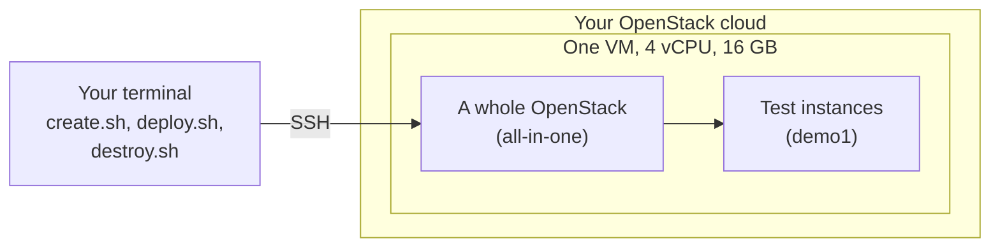

# OpenStack on one VM of an OpenStack cloud

A complete OpenStack (2026.1, deployed with Kolla-Ansible) on a single VM of any OpenStack cloud, in about an hour.
One command deletes it all.

## Quick start

```bash
cp config.example.env config.env && $EDITOR config.env   # OS_CLOUD, NETWORK, SSH_FROM, COST_PER_HOUR
./create.sh                                              # shows the cost, asks, creates the VM (3 min)
./deploy.sh                                              # deploys OpenStack on it (53 min)
ssh -i .state/quicklab-1/id_ed25519 ubuntu@<vm-address>  # the lab is yours: openstack server list
./destroy.sh                                             # deletes everything, after asking (under 1 min)
```

Read [the cost risk](#the-cost-risk) first. The rest of this page is the detail.

## What you get



| Script | What it does | Measured |
|---|---|---|
| `create.sh` | Creates one VM (4 vCPU, 16 GB RAM, 50 GB disk), its key, security group, port and, if you want one, a floating IP. Shows the estimated cost per hour and asks before creating anything | 3 min |
| `deploy.sh` | Installs Kolla-Ansible on the VM and deploys OpenStack all-in-one: Keystone, Glance, Nova, Neutron (Open vSwitch), Placement, Heat, Horizon. Ends with a test instance reachable on a floating IP | 53 min |
| `destroy.sh` | Deletes everything `create.sh` created, after asking, and checks that nothing is left | under 1 min |

## The cost risk

The VM costs money **every hour it exists**, used or not, until you run `./destroy.sh`.

| Your cloud | What to do |
|---|---|
| **Prepaid** | Spending cannot go beyond the credit you loaded. Check your provider's own terms before you rely on it. |
| **Pay-as-you-go** | Set a budget alert in your provider's console **before** you start. Destroy the lab the same day. |

`create.sh` prints the estimate from `COST_PER_HOUR` and waits for your confirmation:

- Copy `COST_PER_HOUR` from your provider's price list.
- Include everything your provider bills for the lab: the flavor, and, if billed apart, the root volume (created when
  the flavor has no 50 GB disk) and the floating IP (if you use one).
- `create.sh` refuses to start while `COST_PER_HOUR` is empty. `./create.sh --no-cost-estimate` creates the lab
  anyway, without an estimate.

### What a lab cost on the reference cloud

Measured on the reference cloud, a prepaid OpenStack cloud (see the [home page](../../README.md#pick-your-lab)). It
bills per second. Prices are its pay-as-you-go prices per hour, as listed on 2026-10-23 and checked again on
2026-10-24. Its pricing page shows them in TND, and in EUR when you switch currency. The EUR prices are the page's
own, not a conversion, so the ratio varies from row to row. The page says nothing about taxes.

| Resource | Used by the lab | TND per hour | EUR per hour |
|---|---|---|---|
| Flavor `G0.basic.4c16g` (4 vCPU, 16 GB, 50 GB disk) | Always: `create.sh` chose it | 0.196 | 0.057 |
| Floating IP | Only if you set `FLOATING_NETWORK` | 0.015 | 0.005 |
| Root volume, 50 GB, HDD (0.000070 TND or 0.000056 EUR per GiB per hour) | No: the flavor has its own disk | (0.0035) | (0.0028) |

| | TND | EUR |
|---|---|---|
| One full run, `create.sh` to `destroy.sh`: 56 min 41 s, measured on 2026-10-23 | 0.19 (0.20 with a floating IP) | 0.05 (0.06 with a floating IP) |
| Each extra day the lab is left running | 4.70 (5.06 with a floating IP) | 1.37 (1.49 with a floating IP) |

- These figures are the measured duration multiplied by the listed prices, not an amount read from an invoice.
- The exercises add their own time: about 0.20 TND (0.06 EUR) per hour.
- On the reference cloud, set `COST_PER_HOUR="0.196"` and `CURRENCY="TND"` (`0.211` with a floating IP), or the EUR
  prices with `CURRENCY="EUR"`.

## What you need

- An account on an OpenStack cloud, with a quota for one VM of 4 vCPU and 16 GB of RAM.
- On your computer: `bash` 4.4 or later (macOS ships 3.2: install a newer one, for example with Homebrew), `ssh`,
  `python3`, and the OpenStack client (`pip install python-openstackclient`).
- A `clouds.yaml` for that account in `~/.config/openstack/clouds.yaml` (download it from your cloud's dashboard:
  *API Access*). The scripts never copy it anywhere.
- A network of your project with Internet access (a router).
- A way to reach the VM: a floating IP, or a host of the same network.
- No direct Internet access in your project? The scripts can use an HTTPS proxy and an NTP server instead (see
  `config.example.env`).

## Steps

```bash
cp config.example.env config.env
$EDITOR config.env            # at least OS_CLOUD, NETWORK, SSH_FROM, COST_PER_HOUR; FLOATING_NETWORK if you use one
./create.sh                   # shows what it will create and the cost, asks, creates
./deploy.sh                   # about an hour; can be run again after a failure, it resumes
ssh -i .state/<prefix><lab>/id_ed25519 ubuntu@<vm-address>
source ~/kolla-venv/bin/activate; . /etc/kolla/admin-openrc.sh
openstack server list          # demo1, the test instance
./destroy.sh                  # when you are done: deletes everything, after asking
```

### How resources are named

Every resource is named from your `PREFIX` (default `quicklab-`) and `LAB` (default `1`):

| Resource | Name |
|---|---|
| VM | `quicklab-1` |
| Key, security group, port | `quicklab-1-key`, `quicklab-1-sg`, `quicklab-1-port` |
| Root volume (only when the flavor has no disk and the VM boots from a volume) | `quicklab-1-root` |

- `destroy.sh` finds them by these names, even if the creation failed half-way or `.state/` was lost. It fails
  loudly if anything is left.
- Two labs side by side need two values of `LAB`.
- The private key and the IDs of what was created are kept in `.state/<prefix><lab>/` (ignored by git).

## Inside the lab

On the VM, load the OpenStack client and the admin credentials:

```bash
source ~/kolla-venv/bin/activate
. /etc/kolla/admin-openrc.sh
openstack server list
```

`deploy.sh` ends with Kolla-Ansible's demo set-up (`init-runonce`) and a test instance. What exists then, for the
exercises:

| Name | What it is |
|---|---|
| `cirros` | The CirrOS test image |
| `m1.tiny`, `m1.small`, `m1.medium`, … | Flavors |
| `demo-net` | A tenant network (a private range set in `remote-deploy.sh`), behind the router `demo-router` |
| `public1` | The lab's external network, range `LAB_EXT_CIDR` (see `config.example.env`); its floating IPs are reachable from the VM itself |
| `mykey` | A key pair; its private key is `~/.ssh/id_ecdsa` on the VM (`ssh -i ~/.ssh/id_ecdsa cirros@<floating-ip>`) |
| `demo1` | The test instance, with a floating IP from `public1` |

### Horizon, the dashboard

Horizon runs on the VM, on port 80 of its address in `NETWORK`. The VM's security group only lets SSH and ping in,
so reach Horizon through an SSH tunnel. On your computer, in the directory of the scripts:

```bash
ssh -i .state/<prefix><lab>/id_ed25519 -N -L 8080:<vm-fixed-address>:80 ubuntu@<vm-address>
```

- `<vm-address>` is the address you log in to.
- `<vm-fixed-address>` is the VM's address in `NETWORK` (`VM_FIXED_ADDRESS` in `.state/<prefix><lab>/state.env`).
  Without a floating IP, it is the same as `<vm-address>`.
- `deploy.sh` prints this command, filled in, at the end. Leave it running and open <http://localhost:8080>.
- Log in with the user `admin`. Stop the tunnel with Ctrl-C.

The password is in `/etc/kolla/passwords.yml` on the VM. It is also the `OS_PASSWORD` of
`/etc/kolla/admin-openrc.sh`:

```bash
sudo grep '^keystone_admin_password' /etc/kolla/passwords.yml
```

## What `deploy.sh` does, and why

| Step | Why |
|---|---|
| Turns off automatic upgrades (`unattended-upgrades`) | On an earlier lab they upgraded `libc6` and `systemd` in the middle of a deploy |
| Synchronises the clock (your `NTP_SERVER` if set) | Kolla-Ansible's prechecks refuse to deploy on an unsynchronised clock |
| Proxy for apt, pip, Docker and the containers, if `HTTPS_PROXY` is set; apt over HTTPS if `APT_HTTPS=yes` | Clouds whose projects have no direct Internet access |
| A veth pair as the lab's external network | One network interface is enough; floating IPs of the lab are reachable from the VM itself |
| Installs `docker` and `dbus-python` in Kolla-Ansible's virtual environment | On an all-in-one, Ansible runs that environment's Python on the VM itself |
| `enable_haproxy: "no"` and `enable_proxysql: "no"` | One node: no load balancer needed, and ProxySQL would take MariaDB's port |
| `global_physnet_mtu` set to the VM's MTU | Cloud networks often have an MTU below 1500; Neutron must know it |
| `nova_compute_virt_type: kvm` when the VM offers nested virtualisation, `qemu` otherwise | Instances are much faster with KVM; `qemu` still works |
| Checks that Docker really uses its proxy after `bootstrap-servers` | A Docker that ignores its proxy fails every image pull |
| `prechecks --use-test-images` when the images come from quay.io | Kolla-Ansible 2026.1 refuses the quay.io images, which are published for testing, unless told so; a lab is that use |

The full reasoning, with the errors met while building this lab, is in the
[all-in-one lab pattern](https://github.com/OzarLand/kolla-ansible-deployment-patterns/blob/main/topologies/all-in-one-lab-on-a-single-vm.md).

## Releases

Measured on 2026-10-23, on the reference cloud: OpenStack 2026.1, Kolla-Ansible 22.2.0, ansible-core 2.20.10, images
from quay.io, Ubuntu 24.04 VM with nested KVM, a project without direct Internet access (through an HTTPS proxy).
The last full run, from `create.sh` to `destroy.sh`, took 57 minutes:

| Step of `deploy.sh` | Time |
|---|---|
| Prepare the host | 5 min 52 s |
| Install Kolla-Ansible | 2 min 22 s |
| Configuration, `bootstrap-servers`, `prechecks` | 3 min 26 s |
| `pull` (images from quay.io) | 17 min 53 s |
| `deploy` | 21 min 21 s |
| `post-deploy`, smoke test (an instance, a floating IP, ping and SSH) | 2 min 19 s |

## When something fails

- `deploy.sh` prints the failing task of `kolla-ansible`. The full logs stay on the VM, in `~/.quicklab/`.
- Fix the cause and run `./deploy.sh` again: it skips the steps already done.
- To start again from scratch: `./destroy.sh`, then `./create.sh`.

## Limits

- One node: no high availability, no Cinder, no Octavia. Enough to learn, break and repair the core services.
- Tested on one cloud so far (see the timings above). Reports from other clouds are welcome.

**Done for the day? Run `./destroy.sh`.** Then check that nothing is left:
[delete everything when you are done](../../README.md#delete-everything-when-you-are-done).
